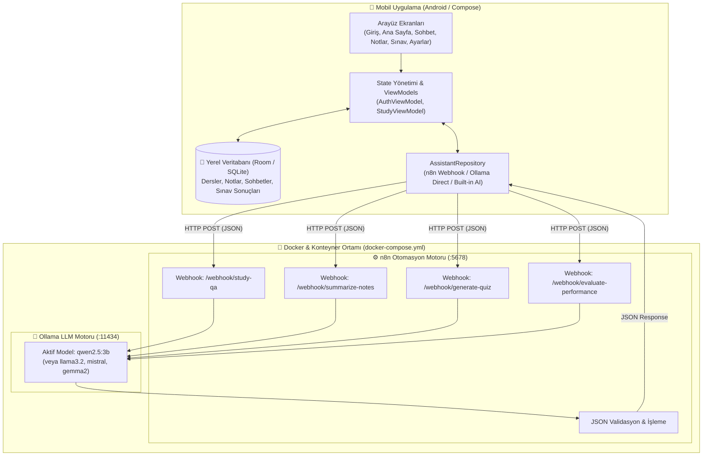

# 🎓 Akıllı Ders ve Soru Asistanı
### Flutter / Android · n8n · Docker · Ollama (Qwen2.5:3b) · Room SQLite

Yapay zekâ destekli modern mobil eğitim asistanı; üniversite öğrencilerinin ders notlarını analiz eder, sorularını pedagojik olarak yanıtlar, ders notlarından otomatik 5 soruluk test oluşturur ve test sonuçlarına göre kişiselleştirilmiş çalışma önerileri sunar.

---

## 🏗️ 1. Sistem Mimarisi (Architecture Diagram)



### ASCII Akış Şeması
```text
+-------------------------------------------------------------------------+
|                  ÖĞRENCİ MOBİL UYGULAMASI (ANDROID)                     |
|  - Ders Notu Yükleme  - AI ile Özetleme  - Soru-Cevap  - Otomatik Test  |
+------------------------------------+------------------------------------+
                                     | (HTTP Webhook / JSON)
                                     v
+-------------------------------------------------------------------------+
|                n8n WORKFLOW ENGINE (DOCKER PORT 5678)                   |
|  1. /webhook/study-qa              -> Ollama Prompt -> JSON Cevap       |
|  2. /webhook/summarize-notes       -> 5 Maddelik Özet Çıkarma           |
|  3. /webhook/generate-quiz         -> 5 Çoktan Seçmeli Soru JSON'ı      |
|  4. /webhook/evaluate-performance  -> Eksik Konu Analizi & Çalışma Planı|
+------------------------------------+------------------------------------+
                                     | (HTTP POST :11434/api/generate)
                                     v
+-------------------------------------------------------------------------+
|                    OLLAMA YEREL LLM (PORT 11434)                       |
|                   Model: qwen2.5:3b (veya llama3.2)                     |
+-------------------------------------------------------------------------+
```

---

## 🚀 2. Hızlı Kurulum ve Çalıştırma

### Adım 1: Docker ve Konteynerleri Başlatma
Proje ana dizinindeki `docker-compose.yml` dosyasını çalıştırın:
```bash
docker compose up -d
```
Bu komut iki servisi ayağa kaldırır:
- **Ollama**: `http://localhost:11434`
- **n8n**: `http://localhost:5678`

### Adım 2: Ollama Modelini İndirme
Konteyner çalıştıktan sonra önerilen modeli indirin:
```bash
docker exec -it ollama ollama run qwen2.5:3b
```
*(Düşük bellekli sistemler için `qwen2.5:1.5b` veya `gemma2:2b` de kullanılabilir).*

### Adım 3: n8n İş Akışlarını (Workflows) İçe Aktarma
1. Tarayıcınızda `http://localhost:5678` adresini açın.
2. Sol menüden **Workflows -> Import from File** seçeneğine tıklayın.
3. Proje içerisindeki `n8n_workflows/study_assistant_workflow.json` dosyasını seçip içe aktarın.
4. Sağ üstteki **Publish / Active** butonunu aktif hale getirin.

---

## 📱 3. Mobil Uygulama Özellikleri

1. **Giriş Ekranı (Login)**:
   - Form doğrulama (e-posta & şifre kontrolleri).
   - Tek tıkla hızlı demo girişi (Mahmut Şibal profili).
2. **Ana Sayfa (Dashboard)**:
   - Kayıtlı üniversite dersleri listesi (Veri Yapıları, İşletim Sistemleri, Algoritmalar, Veritabanı, Yapay Zekâ).
   - Başarı grafikleri ve istatistik kartları (Ortalama skor, çözülen test sayısı).
   - Haftalık çalışma programı (Haftalık AI çalışma takvimi).
   - Son işlemler ve test geçmişi.
3. **Sohbet Ekranı (AI Soru-Cevap)**:
   - n8n `/webhook/study-qa` ve Ollama entegrasyonu.
   - Derse göre filtreleme ve sohbet geçmişi (Room SQLite).
   - Hızlı soru öneri etiketleri (BST, Deadlock, Big-O vb.).
4. **Ders Notları Ekranı (Notes & Summary)**:
   - Not metni veya TXT içeriği girme.
   - Hazır şablon ders notları (Hızlı test için tek tıkla yükleme).
   - n8n `/webhook/summarize-notes` ile yapay zekâ özeti ve 5 anahtar nokta çıkarma.
   - "Bu Nottan Test Oluştur" butonu ile doğrudan test üretme.
5. **Test Ekranı (Quiz / Sınav)**:
   - Soru navigasyonu, sayaç ve ilerleme çubuğu.
   - Test bitmeden doğru cevap gösterilmez (Öğrenci sınav güvenliği).
   - Sınav bitiminde detaylı karne (Doğru, Yanlış, Boş, Başarı Yüzdesi).
   - n8n `/webhook/evaluate-performance` ile **Kişiselleştirilmiş Yapay Zekâ Çalışma Önerisi ve Eksik Konu Analizi**.
6. **Ayarlar & Entegrasyon (Settings)**:
   - n8n Webhook URL (`http://10.0.2.2:5678` - Android Emülatöründen host makineye).
   - Ollama API URL (`http://10.0.2.2:11434`).
   - Çalışma modu seçimi: n8n Webhook, Doğrudan Ollama veya Yerleşik Akıllı Motor.
   - "Bağlantıyı Test Et (Ping)" butonu.

---

## 🧪 4. Canlı Demo ve Değerlendirme Senaryosu

1. **Giriş**: "Hızlı Demo Girişi"ne tıklayın.
2. **Ders Notu Yükleme & Özet**:
   - Alt menüden **Ders Notları** sekmesine geçin.
   - "BST & Ağaç" şablon butonuna tıklayın.
   - **AI ile Özetle** butonuna basın. Yapay zekâ saniyeler içinde notun özetini ve 5 anahtar noktasını çıkaracaktır.
3. **Test Oluşturma**:
   - **Test Oluştur** butonuna basın.
   - Yapay zekâ, ders notundan 5 çoktan seçmeli soru üretir ve test ekranına yönlendirir.
4. **Testi Çözme & Performans Değerlendirmesi**:
   - Soruları işaretleyin ve "Testi Bitir"e tıklayın.
   - Karne ekranında skorunuzu, doğru cevap açıklamalarını ve en önemlisi **Ollama/n8n tarafından üretilen kişiselleştirilmiş çalışma tavsiyesini** görüntüleyin!
